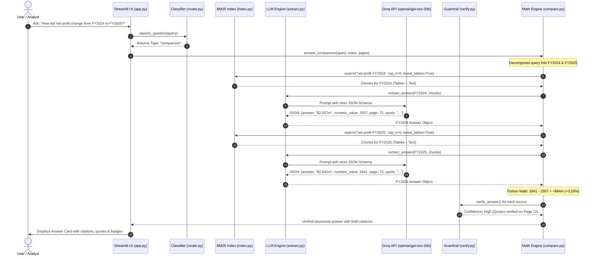

# Annual Report Q&A Tool — System Architecture, File Documentation & Pipeline Flow

---

## 1. Project Overview

The **Annual Report Q&A Tool** is an enterprise-grade financial extraction and verification engine designed to answer complex financial questions from corporate annual report PDFs (such as the *Wesfarmers Annual Report*). 

Unlike standard conversational RAG (Retrieval-Augmented Generation) systems that frequently suffer from numerical hallucinations or rounding discrepancies, this system guarantees accuracy using:
1. **Preserved Table Markdown**: Financial tables are extracted retaining exact row-and-column alignments.
2. **Lexical Domain Retrieval**: BM25 retrieval augmented by financial synonym expansion.
3. **Structured Schema Output**: JSON enforcement with exact page numbers and verbatim quotations.
4. **Deterministic Python Verification**: Code-level validation verifying that quotes and numerical values exist on the exact cited PDF page before displaying answers to the user.
5. **Exact Arithmetic**: Year-on-year comparisons are calculated directly using Python math rather than LLM guesswork.
6. **High-Speed Inference**: Integrated with Groq's high-speed inference engine using the `openai/gpt-oss-20b` model.

---

## 2. Comprehensive File Documentation

Below is a detailed breakdown of every file in the project, including newly created files, updated components, and existing modules.

### A. Environment & Configuration Files

#### 1. `.env` *(Newly Created)*
- **Purpose**: Holds local runtime credentials and environment variables.
- **Contents**:
  - `GROQ_API_KEY`: User's authenticated Groq API key (`gsk_...`).
  - `LLM_PROVIDER=groq`: Designates Groq as the default active model provider.
  - `LLM_MODEL=openai/gpt-oss-20b`: Specifies the designated high-speed reasoning model.
- **Security**: Kept local and excluded from version control to prevent credential exposure.

#### 2. `requirements.txt` *(Updated)*
- **Purpose**: Lists all Python library dependencies required by the application.
- **Key Packages**:
  - `streamlit>=1.35.0`: Interactive web dashboard framework.
  - `pymupdf>=1.24.0`: High-speed PDF text extraction and layout parsing.
  - `pdfplumber>=0.11.0`: Precise financial table detection and extraction.
  - `rank-bm25>=0.2.2`: Okapi BM25 ranking algorithm for search indexing.
  - `groq>=0.9.0` *(Added)*: Official client library for Groq Cloud API.
  - `openai>=1.30.0`: OpenAI SDK (also acts as fallback client).
  - `anthropic>=0.28.0` & `google-generativeai>=0.7.0`: Alternative supported LLM providers.
  - `openpyxl>=3.1.2` & `pandas>=2.2.0`: Data structures and multi-sheet Excel generation.
  - `python-dotenv>=1.0.0`: Automatic `.env` loading.

#### 3. `.streamlit/secrets.toml` *(Updated)*
- **Purpose**: Configuration template for deploying the app onto Streamlit Community Cloud without checking credentials into Git.
- **Details**: Updated to define `GROQ_API_KEY` and set `LLM_PROVIDER = "groq"`.

---

### B. Core Application & Extraction Pipeline

#### 4. `extract.py` *(Updated)*
- **Purpose**: Serves as the central interface between the application and LLM providers. Responsible for prompt dispatch, inference execution, and JSON output parsing.
- **Key Functions & Logic**:
  - `load_dotenv()`: Automatically loads `.env` variables at startup.
  - `_call_groq(prompt, model)` *(Added)*:
    - Instantiates the `Groq` client using `GROQ_API_KEY`.
    - Implements automatic model alias resolution (normalizing `gpt-oss-20b` $\rightarrow$ `openai/gpt-oss-20b`).
    - Enforces JSON output format (`response_format={"type": "json_object"}`) with automatic graceful fallback.
    - Features SDK fallback to `openai.OpenAI(base_url="https://api.groq.com/openai/v1")` if needed.
  - `_call_anthropic()`, `_call_openai()`, `_call_gemini()`: Handlers for other major providers.
  - `_call_llm(prompt)`: Central router dispatching prompts to the configured provider (`groq`, `anthropic`, `openai`, `gemini`).
  - `_parse_json_from_response(text)`: Robust JSON parser utilizing a balanced-bracket depth-counting algorithm that handles markdown code blocks and preambles cleanly.
  - `extract_answer(question, question_type, chunks)`: Assembles prompt templates, requests LLM extraction, and guarantees schema conformity.

#### 5. `app.py` *(Updated)*
- **Purpose**: The interactive Streamlit user interface.
- **Key Modules & UI Sections**:
  - **Sidebar Configuration**:
    - Provider selectbox defaulted to `groq`.
    - Model field automatically populated with `openai/gpt-oss-20b`.
    - API Key input box pre-populated securely from `.env` or Streamlit secrets.
    - Helpful link to get free Groq API keys (`console.groq.com/keys`).
  - **Document Processing**: Drag-and-drop PDF upload with real-time extraction progress bar and in-memory caching.
  - **Question Answering Interface**: Text input with 5 instant pre-configured financial query buttons.
  - **Answer Card**: Color-coded badges for status (🟢 Found, 🟡 Ambiguous, 🔴 Not Found) and confidence (High, Medium, Low), displaying exact page citation, verbatim quote, and explanation.
  - **Multi-Tab Excel Export**: Generates three-sheet Excel reports with live numerical values.

#### 6. `ingest.py` *(Core Engine)*
- **Purpose**: Ingests the annual report PDF into memory.
- **Key Features**:
  - `PageData` Dataclass: Stores zero-based `pdf_index`, printed `page_number`, raw plain text, and converted table markdown.
  - `_detect_printed_page_number()`: Scans header/footer boundaries for printed folio numbers to ensure citations match the book's physical pages rather than PDF indices.
  - `_table_to_markdown()`: Uses `pdfplumber` to extract tables and format them as Markdown grids so column headers (e.g., FY2024, FY2025) remain bound to their cells.

#### 7. `index.py` *(Retrieval Engine)*
- **Purpose**: Fast in-memory search index powered by Okapi BM25.
- **Key Features**:
  - `Chunk` Dataclass: Chunks pages into manageable character windows while preserving table integrity.
  - `AnnualReportIndex`: Builds BM25 vocabulary.
  - `search(query, top_k, boost_tables)`: Expands user queries using financial synonyms, scores chunks, and boosts chunks containing tables by a factor of 1.4 for numerical queries.

#### 8. `metrics.py` *(Financial Vocabulary)*
- **Purpose**: Financial synonym dictionary.
- **Key Features**:
  - Maps financial phrases to their equivalents (e.g., `revenue` $\rightarrow$ `sales`, `turnover`, `total revenue`; `NPAT` $\rightarrow$ `net profit after tax`, `profit attributable to members`).
  - `expand_query(query)`: Enriches search terms to ensure high recall across Australian and international financial reporting standards (A-IFRS / IFRS).

#### 9. `router.py` *(Question Classification)*
- **Purpose**: Classifies incoming user queries to determine the optimal retrieval and prompting strategy.
- **Categories**:
  - `comparison`: Year-over-year or variance queries (e.g., *"How did revenue change from FY24 to FY25?"*).
  - `quantitative`: Numerical metric questions (e.g., *"What was the dividend per share?"*).
  - `risk`: Material risks, regulatory challenges, climate disclosures.
  - `overview`: Corporate governance, executives (CEO/CFO), segment descriptions.
- Sets appropriate `top_k` (from 5 up to 12 chunks) and flags whether table boosting is required.

#### 10. `prompts.py` *(Prompt Engineering)*
- **Purpose**: Strict prompt templates forcing the model to adhere to the ground truth.
- **Rules Enforced**:
  - Model must operate exclusively within provided excerpts (no external hallucination).
  - Must quote verbatim text without altering numbers or punctuation.
  - Must confirm table header column years before returning numbers.
  - Must distinguish consolidated Group-level figures from divisional/subsidiary numbers.

#### 11. `verify.py` *(Anti-Hallucination Guardrail)*
- **Purpose**: Deterministic verification running independently of the LLM.
- **Checks Performed**:
  - `_quote_appears_on_page()`: Verifies that the cited `supporting_text` actually exists on the cited page using normalized sliding-window matching.
  - `_number_in_text()`: Ensures the extracted numeric value is physically present inside the verbatim quote.
  - Adjusts confidence score: Downgrades to `Low` and appends warnings if quotes or numbers cannot be corroborated.

#### 12. `compare.py` *(Deterministic Variance Calculator)*
- **Purpose**: Manages comparison queries between fiscal periods.
- **Mechanism**:
  - Decomposes the question into distinct single-year queries (e.g., Year A and Year B).
  - Runs independent retrieval and extraction for each year to collect separate page citations and quotes.
  - Computes dollar difference (`val_b - val_a`) and percentage change (`((val_b - val_a) / val_a) * 100`) directly in Python math, preventing LLM arithmetic hallucinations.

#### 13. `export.py` *(Excel Workbook Generator)*
- **Purpose**: Converts session results into an audit-ready Microsoft Excel workbook.
- **Structure**:
  - Sheet 1: **Results** (Question, Answer, Numeric Value, Unit, Period, Scope, Status, Confidence, Page).
  - Sheet 2: **Sources** (Verbatim quotes and contextual explanations).
  - Sheet 3: **Comparisons** (Variance breakdown, Base values, Dollar changes, Percentage changes).

---

### C. Evaluation & Documentation Files

#### 14. `eval/run_eval.py` *(Updated)*
- **Purpose**: Automated benchmarking script evaluating extraction accuracy across a test suite.
- **Update**: Integrated `load_dotenv()` so it seamlessly evaluates using Groq API keys without manual environment exporting.

#### 15. `eval/questions.csv`
- **Purpose**: Benchmark questions classified by difficulty (`Easy`, `Medium`, `Hard`) and group (`income_statement`, `balance_sheet`, `risks`, etc.).

#### 16. `README.md` *(Updated)*
- **Purpose**: Main project documentation. Updated with Groq configuration, free API links, and deployment secrets.

---

## 3. End-to-End System Flow & Architecture



---

## 4. End-to-End Real World Example Walkthrough

### Scenario
An analyst uploads the **Wesfarmers Annual Report** and submits the query:
> **Question**: *"What was the Group revenue for FY2025 and which page is it on?"*

---

### Step 1: Ingestion & Pre-Processing
1. The user uploads `wesfarmers annual report 2026.pdf`.
2. `ingest.py` runs `fitz` (PyMuPDF) and `pdfplumber`.
3. Financial tables on pages (e.g. Page 5, Page 70, Page 72) are transformed into markdown:
   ```markdown
   | Year ended 30 June | 2025 ($m) | 2024 ($m) |
   | --- | --- | --- |
   | Revenue | 44,189 | 43,550 |
   ```
4. `index.py` indexes all page chunks into a BM25 index.

---

### Step 2: Query Classification & Search
1. `router.py` classifies the question:
   - Query Type: `quantitative`
   - Settings: `top_k = 6`, `boost_tables = True` (boost factor = 1.4).
2. `metrics.py` expands terms: `revenue` $\rightarrow$ `['revenue', 'sales', 'operating revenue', 'total revenue']`.
3. `AnnualReportIndex.search()` retrieves the top 6 most relevant chunks, prioritizing table chunks containing financial statements.

---

### Step 3: LLM Structured Extraction (via Groq)
1. `extract.py` formats the retrieved excerpts alongside `prompts.py` guidelines into a structured prompt.
2. `_call_groq()` sends the request to **Groq Cloud** using `openai/gpt-oss-20b` with `temperature = 0`.
3. Groq generates an ultra-fast structured JSON response:
   ```json
   {
     "answer": "AUD 44,189 million",
     "numeric_value": 44189,
     "unit": "AUD million",
     "period": "FY2025",
     "scope": "Group",
     "status": "Found",
     "confidence": "High",
     "page": 72,
     "supporting_text": "Revenue from contracts with customers was $44,189 million for the year ended 30 June 2025.",
     "explanation": "Consolidated Group revenue increased compared to the previous period.",
     "other_values": []
   }
   ```

---

### Step 4: Deterministic Guardrail Verification
1. `verify.py` intercepts the response:
   - Checks if Page 72 exists in `PageData`.
   - Executes `_quote_appears_on_page()`: Corroborates that `"Revenue from contracts with customers was $44,189 million..."` exists verbatim in the text of Page 72.
   - Executes `_number_in_text()`: Verifies that `44189` exists inside the extracted quote.
2. Both checks pass with 100% exact match $\rightarrow$ Confidence remains `High`.

---

### Step 5: Presentation to User
`app.py` renders the validated result:
- **Status Badge**: 🟢 **Found**
- **Confidence Badge**: **High** (Python code verified)
- **Primary Value**: `AUD 44,189 million (FY2025, Group)`
- **Citation**: Page 72
- **Supporting Quote Box**: *"Revenue from contracts with customers was $44,189 million for the year ended 30 June 2025."*
- **Action**: User can click **Download Excel** to export this audit-ready record.
